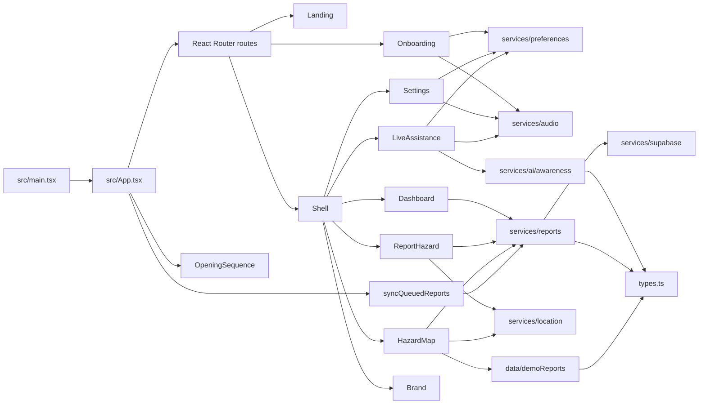
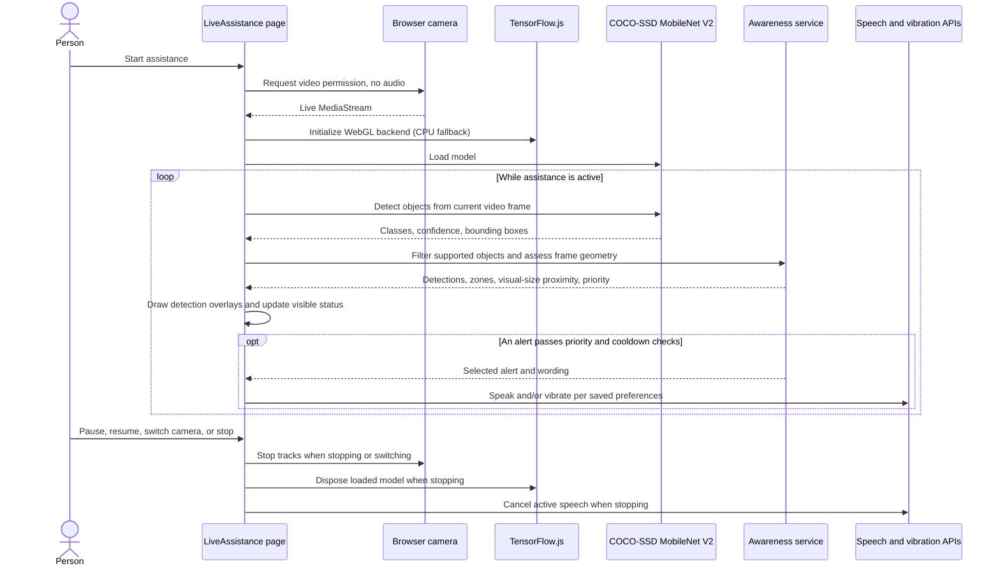
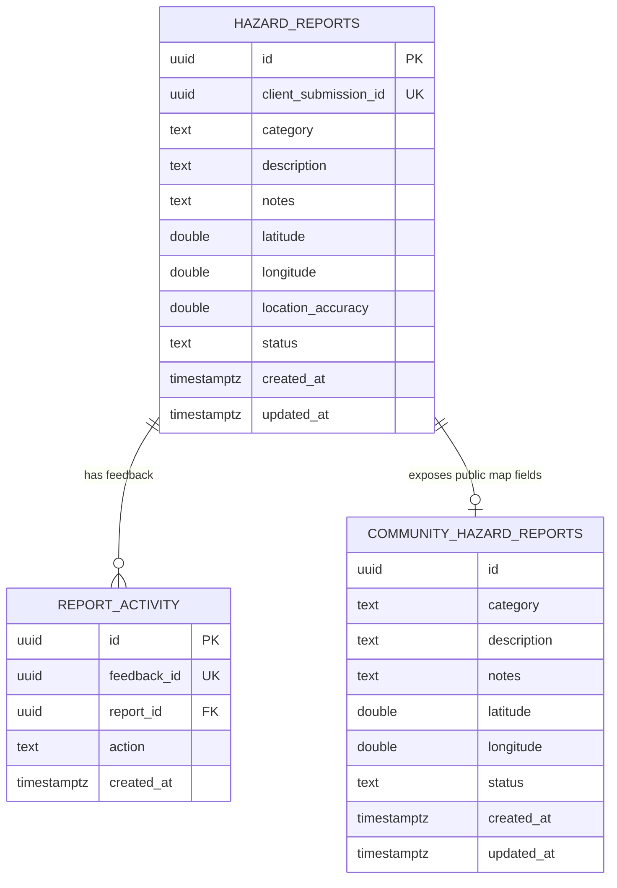

# AccessLens architecture

AccessLens is a mobile-first, installable React web application. Its main capabilities are local camera-based object awareness and community hazard reports. Supabase is optional; the application has no sign-in or Supabase Auth flow.

## System architecture

```mermaid
flowchart TB
  person["Person"]

  subgraph client["AccessLens client — browser or installed PWA"]
    direction TB
    app["Vite application"]
    router["React Router"]
    pages["Pages<br/>Landing · Onboarding · Dashboard<br/>Live Assistance · Report Hazard<br/>Hazard Map · Settings"]
    shell["Shared Shell and navigation"]
    components["Shared components<br/>Brand · OpeningSequence"]
    domain["Types and domain data<br/>Detection · HazardReport · ReportDraft<br/>Preferences · fictional demo reports"]

    subgraph services["Client services"]
      awareness["AI awareness<br/>filter · zone · visual-size proximity<br/>priority · alert cooldown"]
      audio["Audio and haptics"]
      location["Geolocation"]
      preferences["Preferences"]
      reports["Report repository<br/>local persistence · queue · map data"]
      supabaseClient["Optional Supabase client"]
    end

    subgraph browser["Browser capabilities and local storage"]
      camera["Camera and video"]
      tfjs["TensorFlow.js"]
      coco["COCO-SSD MobileNet V2"]
      speech["Speech Synthesis API"]
      vibration["Vibration API"]
      gps["Geolocation API"]
      idb["IndexedDB<br/>local reports, drafts, optional photos"]
      localStorage["localStorage<br/>preferences · cached community reports<br/>feedback IDs · onboarding flag"]
      worker["Generated PWA service worker"]
      appCache["Precached app shell"]
      modelCache["Runtime cache<br/>TensorFlow model assets"]
      tileCache["Runtime cache<br/>OpenStreetMap tiles"]
    end

    app --> router
    router --> pages
    router --> shell
    shell --> components
    pages --> components
    pages --> domain
    pages --> services
    awareness --> domain
    reports --> domain
    preferences --> localStorage
    reports --> idb
    reports --> localStorage
    reports --> supabaseClient
    awareness --> tfjs
    tfjs --> coco
    pages --> camera
    awareness --> audio
    audio --> speech
    audio --> vibration
    location --> gps
    pages --> location
    worker --> appCache
    worker --> modelCache
    worker --> tileCache
  end

  subgraph external["External services"]
    supabase["Supabase project<br/>PostgreSQL · RPC · public view"]
    osmTiles["OpenStreetMap tile server"]
    nominatim["Nominatim place search"]
    modelAssets["TensorFlow model asset host"]
  end

  supabaseClient -->|"anonymous RPC and view queries<br/>only when configured"| supabase
  worker -. "runtime cache" .-> modelAssets
  worker -. "runtime cache" .-> osmTiles
  pages -->|"place search request"| nominatim
  person --> client

  classDef optional stroke-dasharray: 5 5
  class supabaseClient,supabase optional
```



### Runtime and deployment boundaries

- **Frontend:** `src/main.tsx` mounts the React application and router. `src/App.tsx` defines routes, loads preferences, starts queued-report synchronization, and renders the opening sequence. Vite builds and serves the frontend.
- **Page routing:** `/` is the landing page and `/onboarding` is the setup flow. The dashboard, assistance, report, map, and settings routes share the `Shell`. Page chunks other than landing and dashboard are loaded lazily.
- **On-device assistance:** camera frames go from the browser video element directly to TensorFlow.js and COCO-SSD in the browser. The app does not upload or persist camera frames. Detection is available offline only after the app and model resources have been loaded and cached.
- **Optional backend:** `VITE_SUPABASE_URL` and a publishable/anon key enable the Supabase client. No credentials means local-only reporting and fictional sample map data. The browser does not authenticate users or access the report tables directly.
- **PWA:** `vite-plugin-pwa` generates the service worker and manifest during the build. The worker precaches app-shell assets and applies runtime caching to model assets and map tiles. It does not provide a background-sync worker.
- **External map services:** Leaflet renders the map, OpenStreetMap provides tiles, and Nominatim provides place search. These are separate from hazard report storage.

## Frontend module map



| Area | Responsibilities |
|---|---|
| `src/main.tsx`, `src/App.tsx` | Mount React, routing, global styles, preference initialization, opening sequence, and report-queue synchronization on startup and when connectivity returns. |
| `src/components/` | Shared brand, route shell/navigation, and skippable reduced-motion-aware opening sequence. |
| `src/pages/` | Landing, onboarding, dashboard, live assistance, report creation, community map, and device-local settings. |
| `src/services/ai/awareness.ts` | Supported-class filtering, image-relative zone and proximity estimates, alert wording, alert priority/cooldown, and vibration patterns. |
| `src/services/audio.ts` | Speech synthesis and device vibration wrappers. |
| `src/services/location.ts` | Explicit user-triggered browser geolocation. |
| `src/services/preferences.ts` | Read and write device-local assistance and display preferences. |
| `src/services/reports.ts` | IndexedDB report persistence, queued submission/retry, community report query/cache, and “still present” feedback. |
| `src/services/supabase.ts` | Optional configured Supabase browser client; no persistent auth session. |
| `src/data/demoReports.ts` | Clearly labeled fictional map-only examples and JSON download. |
| `src/types.ts` | Shared TypeScript types for detections, reports, drafts, categories, statuses, and preferences. |

## Live assistance flow



The detector runs at reduced resolution/cadence on the client. Only the supported COCO-SSD classes are considered. Left/centre/right and far/medium/near are estimates from bounding-box position and image area; they are not depth measurements or a safe-route assessment. Voice, vibration, and the optional screen wake lock depend on browser/device capabilities.

## Hazard report and map data flow

```mermaid
sequenceDiagram
  actor Person
  participant Form as ReportHazard page
  participant GPS as Browser geolocation
  participant Reports as Report service
  participant IDB as IndexedDB
  participant Supabase as Optional Supabase
  participant DB as PostgreSQL
  participant Map as HazardMap page
  participant Cache as localStorage report cache

  Person->>Form: Enter category, description, location, consent
  opt Person requests current location
    Form->>GPS: Request location
    GPS-->>Form: Coordinates and accuracy
  end
  Form->>Form: Validate fields, coordinates, and sharing consent
  alt Backend configured and browser online
    Form->>Reports: Submit report
    Reports->>Supabase: submit_community_report RPC
    Supabase->>DB: Insert pending report (idempotent submission ID)
    DB-->>Supabase: Report ID
    Supabase-->>Reports: Success or error
    Reports->>IDB: Save local history; optional photo remains local
  else Offline or backend not configured
    Form->>Reports: Save as queued/local report
    Reports->>IDB: Store report draft and optional photo
  end
  opt Submission fails
    Form->>IDB: Preserve report for retry
  end
  Person->>Map: Open community map
  alt Backend configured and online
    Map->>Supabase: Select community_hazard_reports view
    Supabase->>DB: Read non-rejected public map fields
    DB-->>Supabase: Reports with generalized coordinates
    Supabase-->>Map: Community reports
    Map->>Cache: Cache latest successful response
  else Backend missing or offline
    Map->>Cache: Read cached community reports
  end
  opt No backend and no cached reports
    Map->>Map: Show clearly labeled fictional demo reports
  end
  opt Person selects still present on a real report
    Map->>Supabase: submit_report_feedback RPC with stable feedback ID
    Supabase->>DB: Record idempotent still_present activity
  end
```

### Report persistence and backend boundary

- Reports are validated in the form before submission. A community submission requires a category, an 8–280-character description, valid latitude/longitude, and explicit consent. Additional notes are optional and limited to 500 characters.
- IndexedDB database `accesslens-local` stores local drafts, queued reports, local report history, and optional compressed photos. Photo data is never included in the Supabase RPC or uploaded to a storage bucket.
- If Supabase is not configured or the browser is offline, a submitted report is queued locally. When configured and online, the app syncs queued reports at startup and on the browser `online` event. A unique client submission ID makes retries idempotent.
- `hazard_reports` is protected by row-level security and direct browser table access is revoked. `submit_community_report` accepts constrained anonymous pending reports. The browser reads the `community_hazard_reports` view, which excludes rejected reports and rounds coordinates to three decimal places.
- `submit_report_feedback` records idempotent “still present” activity for active pending or verified reports. Report moderation is performed by the project owner in Supabase Studio.
- The map can use its last successful community response from localStorage. With no backend and no cached reports, it displays explicitly fictional examples; demo reports are never submitted.

## Supabase data model



`community_hazard_reports` is a database view, not a separately stored table. It omits `client_submission_id` and `location_accuracy`; coordinates are rounded before exposure. The schema, constraints, RLS, functions, grants, and indexes are defined in [`supabase/migrations/202610300001_accesslens.sql`](../supabase/migrations/202610300001_accesslens.sql). [`supabase/seed.sql`](../supabase/seed.sql) intentionally creates no sample hazards.

## Storage, privacy, and offline behavior

| Data/resource | Location | Behavior |
|---|---|---|
| Camera stream and model input frames | Browser memory | Used for on-device detection only; not uploaded or saved. |
| Report drafts, queued reports, local history, optional photos | IndexedDB | Remain on this device. A photo is retained locally only; it is not part of cloud submission. |
| Preferences and onboarding flag | localStorage | Device/browser-local settings; no user account or cloud profile. |
| Last successful community report response | localStorage | Used when offline or when the backend is unavailable. |
| Feedback submission IDs | localStorage | Reused per report so repeated “still present” actions are idempotent. |
| App shell | Service worker precache | Available offline after the app has been loaded and cached. |
| Model assets | Service worker runtime cache | Cache-first for matching TensorFlow model asset requests after first load. |
| OpenStreetMap tiles | Service worker runtime cache | Stale-while-revalidate for tiles previously requested. |
| Community report text and approximate location | Supabase PostgreSQL, if configured | Explicitly submitted reports remain pending until moderated. |

The app's only automated report retry trigger is startup and the browser `online` event; report drafts that were not submitted are not automatically published. Camera/model availability, location, voice, vibration, and caching behavior vary by browser and device.
