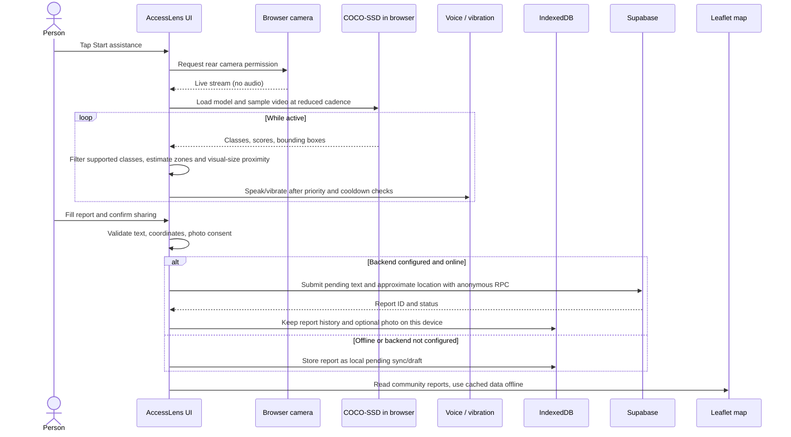

# System flow

## Important operational states

- Camera is requested only after the user starts assistance. Permission, missing device, unsupported browser, model failure, and inference failure have visible recovery states.
- Stopping assistance stops every camera track and releases an optional screen wake lock.
- GPS is requested only from the report/map location button. Users can enter coordinates manually.
- A report needs a category, useful description, valid coordinates, and explicit sharing consent before database submission. Photos stay in local storage and are not uploaded. Saving a local draft does not publish it.
- Only supported COCO-SSD labels can be announced. The shipped model does not detect open drains, steps, poles, footpath damage, or free space.
